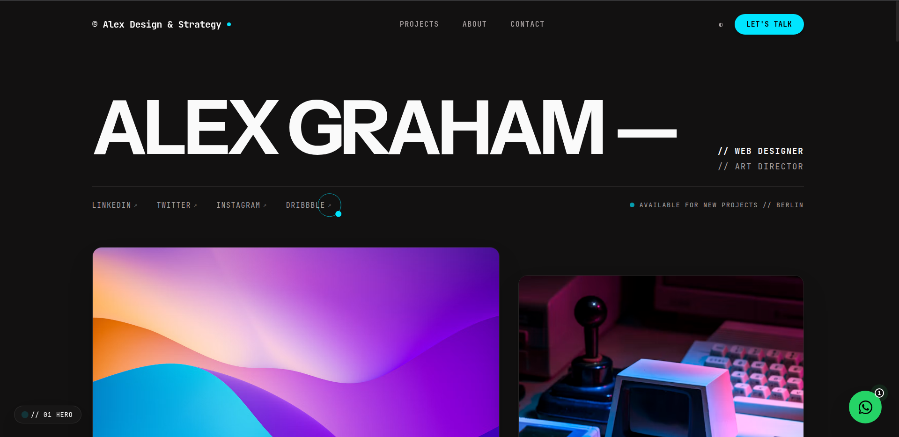

# TD_Alexfolio — Digital Designer & Art Director Portfolio

A bold, high-contrast, editorial portfolio template reverse-engineered from **[Volt Supply's Alexfolio](https://volt.supply/templates/alexfolio)** (by Tom Davidov). Built for digital designers, art directors, product designers, and creative studios showcasing portfolio work with big typography, fluid micro-interactions, scroll-driven sticky animations, and a custom context-morphing cursor.

---

## 📸 Visual Preview & Section Walkthrough

### 1. Hero Section & Asymmetric Bento Grid

* **Giant Bold Display**: `ALEX GRAHAM —` with dual role indicators (`// Web Designer`, `// Art Director`).
* **Live Availability Beacon**: Status beacon (`Available for new projects // Berlin`).
* **Dual Asymmetric Project Showcase**: Wide showcase card (7 cols) and tall showcase card (5 cols, offset) with direct case study links.

---

### 2. // Intro Section (Kinetic Typography)

* **Kinetic Statement**: Letter-by-letter scroll illumination as the user scrolls through the statement.
* **Direct Call to Action**: `See my Work ↓` button with smooth scroll tracking.

---

### 3. // Services (01–04 Modular Deliverables)

* **01 Branding & Marketing**: Strategy, Logo Design, Visual Identity, Brand Guidelines, Motion Design.
* **02 Website Design**: High-Conversion Landing Pages, Corporate Platforms, E-Commerce, Dashboards.
* **03 Web Development**: Framer, Webflow, Custom Code Builds, Headless CMS Integration, SEO Optimization.
* **04 Application Design**: Native iOS & Android Apps, Modern Desktop Apps, Design Systems Optimization.

---

### 4. // Selected Works (Work Index with Live Cursor Preview)

* **Curated Case Studies**: Formula Vintage, Sprey Zest, Super Pro, Architech Buildings, Posnen Gallery, Fringe Sports.
* **Floating Image Preview**: Hovering over any project row summons an image preview card following mouse movement.
* **Dedicated Case Study Pages (`#/project/:id`)**: With specs, brief & solution narrative, before/after slider, and 4K gallery.

---

### 5. // Recognition & Awards and Scroll-Driven Testimonials

* **Recognition and Awards**: SOTD on Awwwards, Honorable Mention, Dribbble Weekly Picks, FWA of the Day, CSSDA, Framer Awards.
* **Scroll-Driven Sticky Testimonials (`01 / 03`)**: Sticky viewport container that pins and smoothly transitions between reviews (**Maya Lopez**, **Ray Brown**, **George Jones**) as the user scrolls, complete with fill bar and active avatar indicators.

---

### 6. // Reach Out — (Contact & Footer Section)

* **Direct Coordinates**: Berlin office address, `hello@alexgraham.com`, `+49 30 12345678`.
* **Interactive Project Proposal Form**: Name, email, service required, project details, and fast quotation pipeline.
* **Minimalist High-Contrast Footer**: Year, location, social links (`Linkedin ↗`, `Twitter ↗`, `Instagram ↗`), and `Back to Top ↑`.

---

## 🌟 Interactive Experience & Polish

### Dual-Layer Context-Morphing Cursor
- **Inner Precision Dot (`#cursor-dot`)**: Follows mouse coordinates with zero latency in Electric Vermilion (`#FF442B`).
- **Outer Follower Ring (`#cursor-ring`)**: Smooth spring lerp motion via `requestAnimationFrame`.
- **Morphing Modes**:
  - Over Links & Buttons: Scales up (`54px`) with soft accent blur.
  - Over Project Rows: Expands to `82px` displaying `VIEW ↗`.
  - Over Testimonials: Displays `SCROLL ↓`.
  - Over Comparison Sliders: Displays `DRAG ↔`.
  - On Click: Instant scale-down bounce feedback (`scale(0.82)`).

### Scroll-Driven Sticky Testimonials Animation (`// Testimonials /03`)
- **Sticky Viewport Pinning**: Utilizes a dedicated vertical scroll track (`#testimonials-scroll-track`) that locks the testimonials container into view as the user scrolls.
- **Scroll-Synchronized Progression**:
  - **0.00 – 0.33 Progress**: Testimonial `01 / 03` (**Maya Lopez**, *CEO, Fundwizz*) with real-time text illumination.
  - **0.33 – 0.66 Progress**: Smooth transition to Testimonial `02 / 03` (**Ray Brown**, *Head of Product, ISO*).
  - **0.66 – 1.00 Progress**: Smooth transition to Testimonial `03 / 03` (**George Jones**, *Product Manager, Gliss*).
- **Interactive Controls**:
  - Horizontal fill bar (`#testimonial-scroll-fill`) tracking scroll progress across all 3 reviews.
  - 3 Circular client avatar selectors with active glowing rings (`ring-2 ring-[var(--color-accent)]`) that allow instant jump-to-review or smooth scrolling.
  - Manual arrow navigation buttons (`←` / `→`).

### High-Contrast Theme Switcher
- Instant toggle between **Alexfolio Matte Dark (`#121111`)** and **Alexfolio Clean Light (`#FAF9F6`)**.
- Electric Vermilion (`#FF442B`) accent color preserved across both themes.
- Persistent choice saved to `localStorage`.

---

## 🛠️ Configuration & Customization

All text, project case studies, client reviews, contact coordinates, and colors are centralized in **`src/config/siteConfig.js`**:

```javascript
// src/config/siteConfig.js
export const siteConfig = {
  studio: {
    name: "Alex Design & Strategy",
    founderName: "Alex Graham",
    roles: ["Web Designer", "Art Director"],
    city: "Berlin",
    country: "Germany",
    address: "Ozeanblickstraße, Berlin 10115, Germany",
    email: "hello@alexgraham.com",
    phone: "+49 30 12345678",
    whatsappNumber: "493012345678",
  },
  colors: {
    accent: "#FF442B", // Alexfolio Electric Vermilion
    bgDark: "#121111",
    bgLight: "#FAF9F6",
  },
  // ... services, projects, awards, testimonials, contact
};
```

---

## 🚀 Quickstart & Development

```bash
# 1. Install dependencies
npm install

# 2. Start local development server with Vite
npm run dev

# 3. Build optimized production bundle
npm run build

# 4. Preview production build locally
npm run preview
```

---

## 📦 Tech Stack

- **Framework**: Vanilla JavaScript (ES Modules, Component Architecture, State Management)
- **Bundler**: [Vite](https://vitejs.dev/)
- **Styling**: [Tailwind CSS v4](https://tailwindcss.com/)
- **Smooth Scrolling**: [Lenis](https://github.com/darkroomengineering/lenis)
- **Icons**: [Lucide](https://lucide.dev/)
- **Fonts**: [Instrument Sans](https://fonts.google.com/specimen/Instrument+Sans), [Inter Tight](https://fonts.google.com/specimen/Inter+Tight), [JetBrains Mono](https://fonts.google.com/specimen/JetBrains+Mono), [DM Mono](https://fonts.google.com/specimen/DM+Mono)
